# Syncra HIMS: class diagrams

The domain model of Syncra HIMS, taken from the database schema (`database/init-schema.sql`,
68 tables in 11 schemas) and the services that work on it. GitHub draws the diagrams below;
elsewhere, paste a block into [mermaid.live](https://mermaid.live).

**How to read them**

- One diagram per area; a class drawn in another area's colour appears only to show the link.
- Attributes are the important fields, not every column. Every entity also has an `id`
  (UUID) and `created_at` / `updated_at`; most record who created or changed them.
- `*--` is composition (the part cannot exist without the whole), `-->` an association,
  `..>` a soft reference (an id or code, not a foreign key). Numbers are multiplicities.
- Links to the member of staff who did something (ordered, signed, reported, dispensed…)
  are left out to keep the diagrams readable: there are 21 of them, all to `Staff`.

Contents:

1. [Overview](#1-overview)
2. [Patients, staff, OPD and wards](#2-patients-staff-opd-and-wards)
3. [Clinical record (EMR)](#3-clinical-record-emr)
4. [Orders, laboratory and imaging](#4-orders-laboratory-and-imaging)
5. [Billing](#5-billing)
6. [Pharmacy](#6-pharmacy)
7. [ABDM as health information provider (HIP)](#7-abdm-as-health-information-provider-hip)
8. [ABDM as health information user (HIU)](#8-abdm-as-health-information-user-hiu)
9. [Sign-in, staff and audit](#9-sign-in-staff-and-audit)
10. [Application services](#10-application-services): [Patient Service](#10a-patient-service), [Billing, Pharmacy and IAM](#10b-billing-pharmacy-and-iam-services), [ABDM](#10c-abdm-service)
11. [AI service](#11-ai-service)

## 1. Overview

The main classes of each area and how they meet. Everything clinical hangs off an
`Encounter`: an OPD visit, an inpatient admission, an emergency or day-care episode.

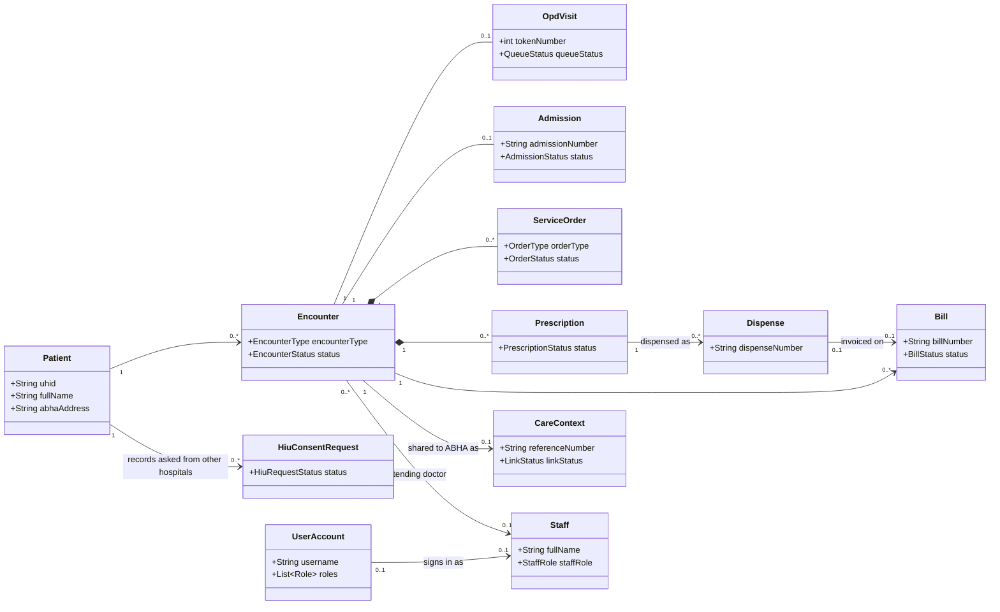

## 2. Patients, staff, OPD and wards

Schemas `core`, `patient`, `opd`, `ipd`. A patient keeps one UHID for life; a duplicate
record is never deleted but can point to the surviving one (`merged_into`). A bed holds at most one patient
at a time (`bed_assignment` with no `released_at`, enforced by the database).

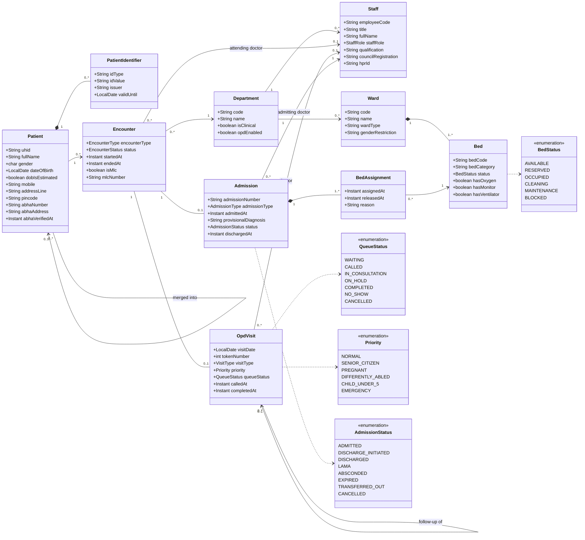

## 3. Clinical record (EMR)

Schema `clinical`. Entries are never deleted: a wrong one is marked entered in error, a
signed note is corrected by an amendment, and an issued prescription cannot change
(database triggers). Entries filled by Shrutlekhan dictation point to their dictation session.

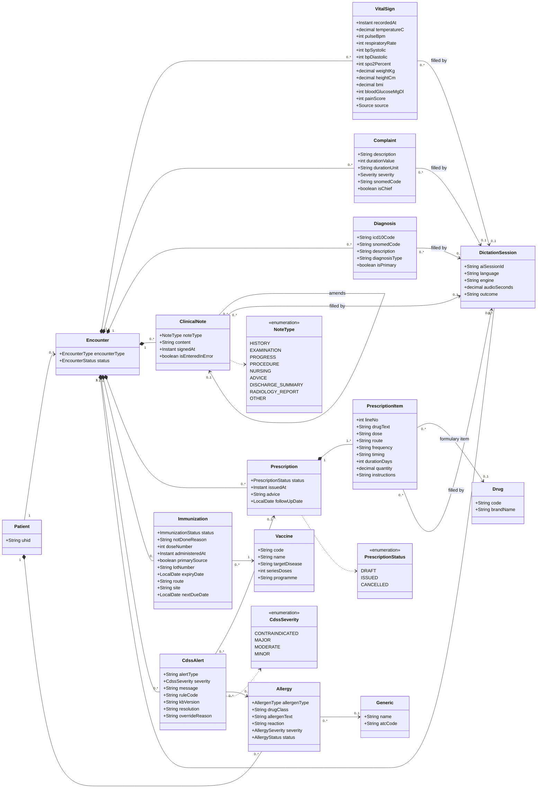

## 4. Orders, laboratory and imaging

Schemas `clinical` and `imaging`. The service catalogue (`billing.service`) is shared:
the same entry is ordered, worked on by the lab or imaging, and billed. The server flags
each lab value from the test's parameters; a critical value opens a `CriticalResult` that
must be phoned through (with read-back) and acknowledged by the doctor.

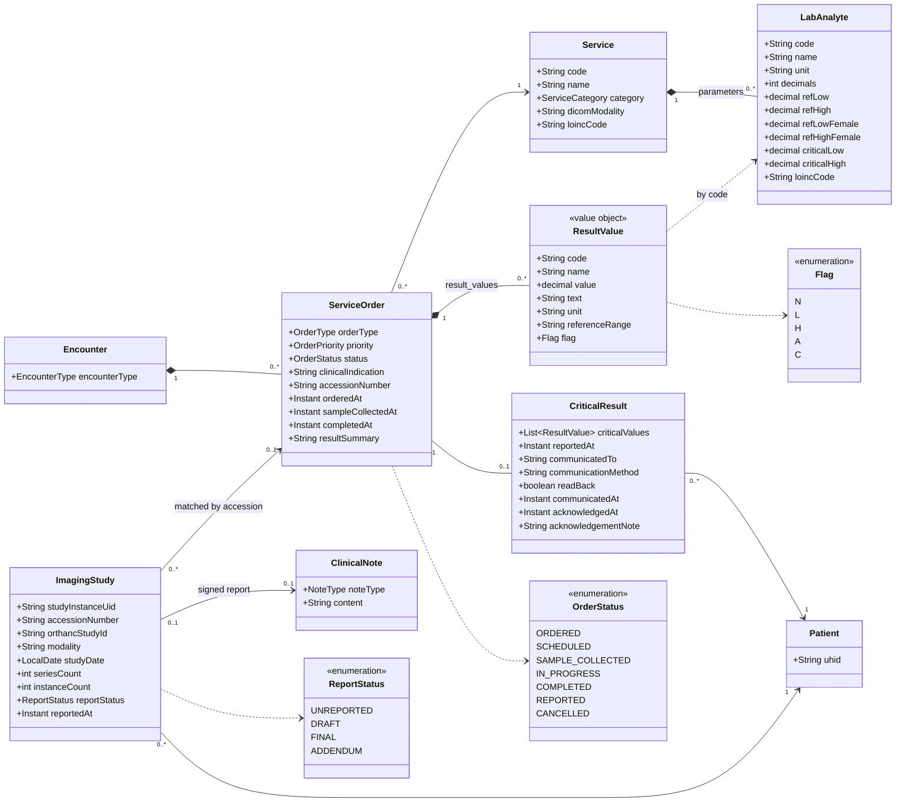

## 5. Billing

Schema `billing`. A bill belongs to one encounter (and, for inpatients, the admission).
Lines are priced from the patient's tariff plan; each line remembers what it came from
(`source_type` + `source_id`: an OPD visit, a bed day, an order, a doctor's visit or a
dispensed medicine). A bill gets its gap-free GST number only when it becomes final, and a
final bill can only be cancelled. Advances are paid against the admission.

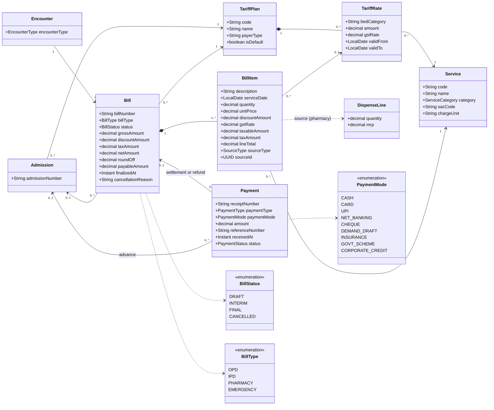

## 6. Pharmacy

Schema `pharmacy`. Stock is held per store and batch; every change is written to the
append-only `StockMovement` ledger. Goods arrive in the main store, move to the OPD
pharmacy by requisition, and leave by dispensing, always earliest expiry first and never
from an expired batch. A dispense is invoiced once, as a pharmacy bill.

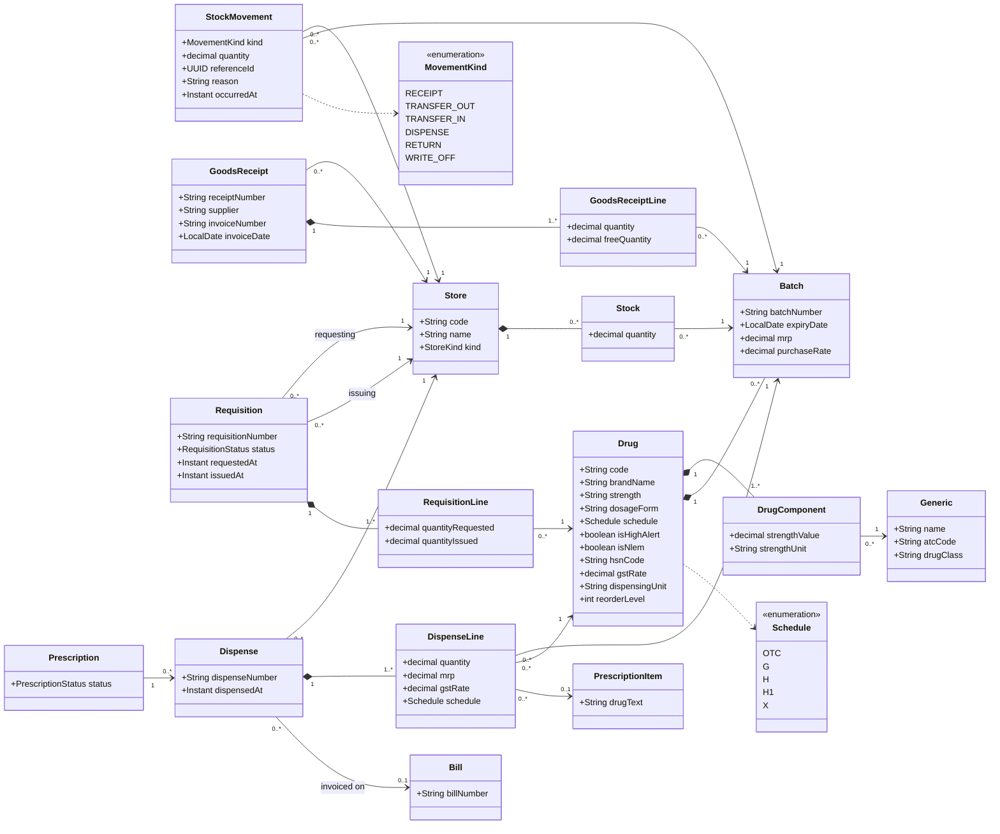

## 7. ABDM as health information provider (HIP)

Schema `abdm`. ABHA verification and creation (Milestone 1), then each encounter becomes a
care context linked to the patient's ABHA, by the hospital or by the patient from their
app (Milestone 2). Under a consent artefact the records are generated from the EMR as FHIR
documents, encrypted and pushed; only each document's hash is kept. Aadhaar numbers are
never stored.

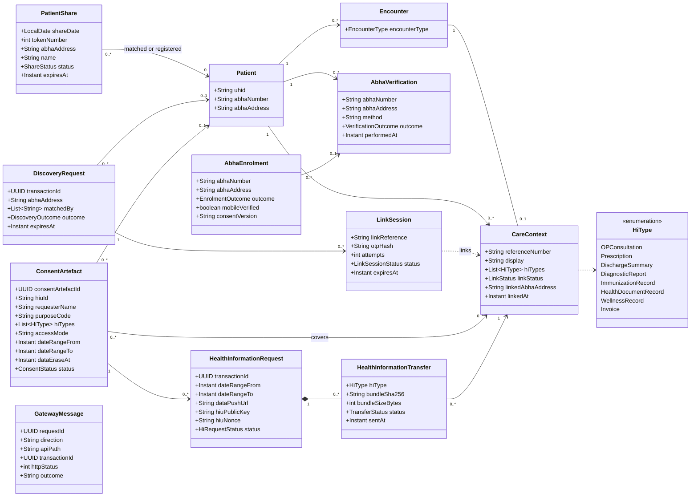

`GatewayMessage` logs every call to and from ABDM (path and status, never the body); a
callback seen before by its `REQUEST-ID` is not processed twice.

## 8. ABDM as health information user (HIU)

Milestone 3: this hospital asking for a patient's records held elsewhere. One consent
request gives one artefact per hospital that holds records; each artefact gets data
requests, and each received document is stored until the consent's erase time. The
one-time decryption key of a data request lives only in the service's memory.

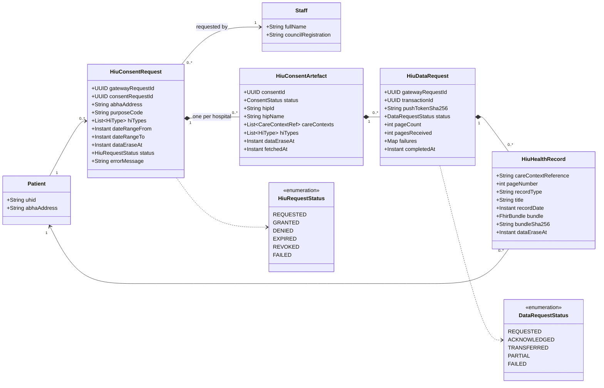

## 9. Sign-in, staff and audit

Schemas `iam` and `audit`. A user account signs in as a staff member (services find the
caller's staff record by the JWT subject, `core.staff.iam_subject`). Refresh tokens are
stored as hashes and chained: each use replaces the token, and reuse of a replaced one ends
the whole family. Sign-in events and the clinical audit log are append-only.

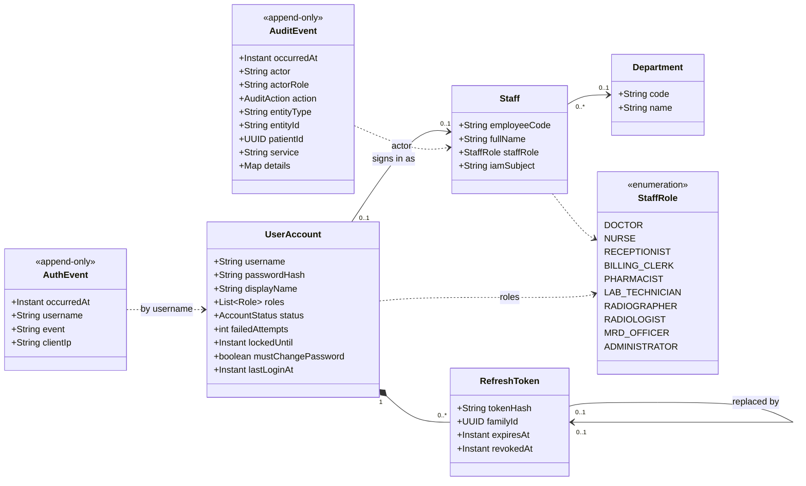

## 10. Application services

The Java services (Spring Boot 3.2, Java 21) and their main operations. Each service is
called through its REST controller behind the API gateway; controllers, repositories and
request/response records are left out. Dashed arrows are calls from one class to another;
the stereotype names the deployable service.

### 10a. Patient Service

Registration, OPD queue, wards and the clinical record. Signing a consultation re-runs the
drug-safety check in the AI service over HTTP.

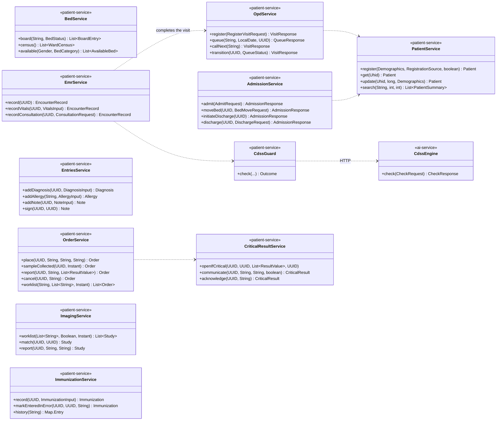

### 10b. Billing, Pharmacy and IAM services

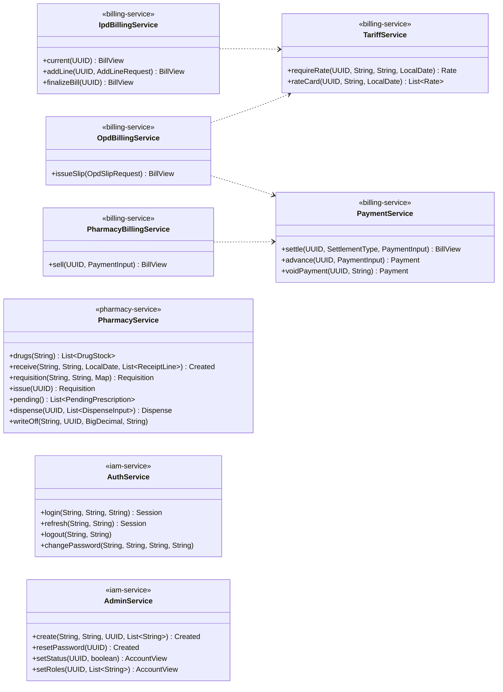

The pharmacy dispenses; the billing service turns a dispense into a GST invoice at MRP
(`PharmacyBillingService.sell`). IAM issues the JWT every other service checks.

### 10c. ABDM service

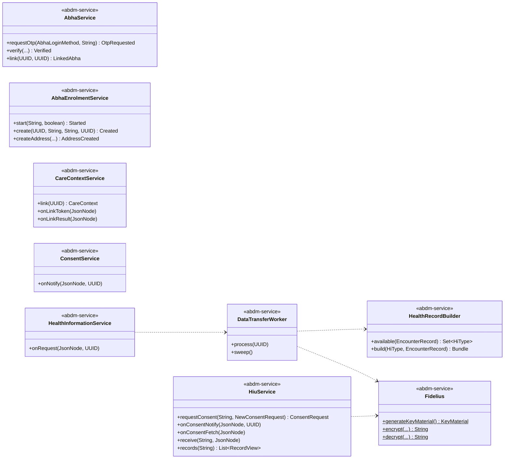

The services share one PostgreSQL database, each through its own schema, and read others'
tables where a flow crosses areas (for example, billing reads the pharmacy dispense it
invoices, and the ABDM service reads the clinical record to build FHIR documents).

## 11. AI service

The Python service (FastAPI) behind the dictation WebSocket and the drug-safety check.

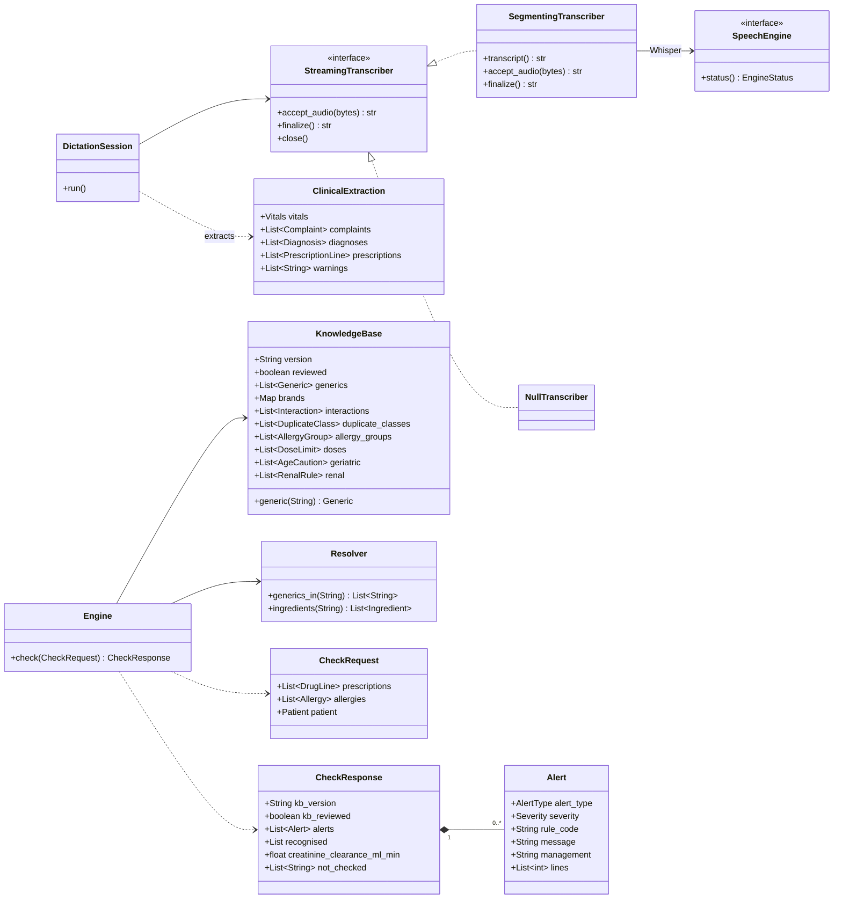
